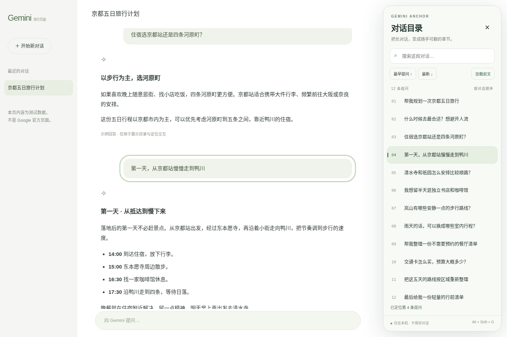

# Gemini Anchor · 对话目录

给 Gemini 长对话加一份侧边目录，搜索前面的内容，点击回到原位置。提供 **Android 官方 App 配套插件**和 **Windows Chrome / Edge 网页扩展**。

[下载安装包](https://github.com/maplecat707-cmd/gemini-conversation-navigator/releases) · [隐私说明](docs/PRIVACY.md) · [验证与兼容范围](docs/TESTING.md)



> 独立开源项目，与 Google 无关联。首版为预览版；Gemini 页面结构、Android App 的无障碍支持可能随版本变化。预览图为本地演示，不能代表已登录账号的兼容性测试。

0.1.1 已在官方未登录 Gemini 网页完成 20 轮真实会话的目录、搜索和跳转验证，并修复隐藏无障碍标题导致提问重复的问题。[实测截图与范围](docs/TESTING.md#011-网页兼容修复)。Android 官方 App 的真机验证仍待完成。

| | Windows 网页扩展 | Android 配套 APK |
|---|---|---|
| 使用位置 | `https://gemini.google.com/` | 官方 Gemini Android App |
| 目录条目 | 按提问排列 | 按 App 可读取的文字段落排列，可能包含回复 |
| 跳转 | 直接滚动到对应提问并短暂高亮 | 逐屏滚动到匹配文字；可停止 |
| 前文 | 点击「加载前文」触发网页历史加载 | 点击「收录前文」逐屏读取并尝试返回起点 |
| 搜索 | 搜索已加载提问，突出关键词 | 搜索本轮已收录文字 |
| 保存 | 对话仅在当前页面内存中 | 对话仅在服务内存中，离开 Gemini 清空 |

## Windows：Chrome / Edge

1. 从 [Releases](https://github.com/maplecat707-cmd/gemini-conversation-navigator/releases) 下载 `gemini-anchor-chrome-edge-0.1.1.zip`，解压到一个固定文件夹。
2. Chrome 打开 `chrome://extensions`；Edge 打开 `edge://extensions`。开启「开发者模式」。
3. 点击「加载已解压的扩展程序」，选择包含 `manifest.json` 的文件夹。
4. 打开或刷新 Gemini 对话，点击右侧「目录」。可用 `Alt+Shift+G` 或浏览器工具栏图标展开／收起。
5. 搜索关键词，点击提问即可定位。「最早提问」回到当前已加载的最早提问；要找更早内容，先点「加载前文」。

加载过程中可以点「停止加载」，或直接滚轮／触屏滚动来停止。完成后会尝试保持开始时的阅读位置。快捷键可在浏览器扩展快捷键设置中修改。

扩展目前通过解压安装，不在 Chrome／Edge 商店发行；更新时解压新版到同一文件夹并在扩展页面点击重新加载。不会修改 Gemini 账号、请求内部 API 或保存登录令牌。

## Android：官方 App 配套插件

需要 **Android 8.0 或以上**。这是独立安装的配套工具，利用系统无障碍服务显示侧栏；Gemini 没有可供侧载的原生插件接口。无需 Root、LSPosed 或修改官方 APK。

1. 从 Releases 下载 `gemini-anchor-android-0.1.0-preview.apk`，允许当前下载工具安装此 APK。
2. 打开「Gemini 对话目录」，阅读权限用途，点击「开启无障碍服务」，在系统设置里启用它。
3. Android 13+ 对侧载应用可能显示「受限设置」：确认来源后，在系统「应用信息」右上菜单允许受限设置，再回到无障碍设置。不同品牌入口可能不同。
4. 打开 Gemini 的一段长对话，点击右侧「目录」→「收录前文」。收录期间不要切换对话；点悬浮「停止」即可中止。
5. 收录结束后展开目录、搜索并点文字条目。定位会自动逐屏滚动，可随时停止。**相同文字重复出现时只能保证找到一个匹配位置**。
6. **在 Gemini 内切换对话后先点「新对话 / 清空」，再重新收录。** Android 不暴露稳定会话 ID，不能可靠自动区分所有切换方式。离开 Gemini 会清空索引并隐藏侧栏。

部分设备的 Gemini 由 Google App 承载。如果打开 Gemini 后没有侧栏，可在本插件里开启「兼容由 Google App 承载的 Gemini」。此模式需页面含 Gemini 标记；普通 Google 搜索不属于支持范围，不要在搜索结果页使用。

Android 定位速度取决于距离、页面加载和无障碍响应，不能像网页一样直接跳到尚未加载的任意节点。一轮自动操作最多 180 步，遇到四次无进展会停止／返回。未读到文字、找不到滚动容器或未找到匹配内容时会明确提示，不会盲点屏幕。部分 Gemini 版本不暴露这些信息，无法支持；详见 [验证记录](docs/TESTING.md)。

预览 APK 使用项目专用签名；私钥不进入仓库。GitHub Actions 的 debug APK 是构建检查产物，签名与 Releases 可能不同，请勿混用覆盖安装。

## 隐私与关闭

两个版本都不上传对话，不调用 AI 接口，不需要 API Key。网页扩展只申请 `storage` 权限以记住侧栏开关状态，注入范围仅为 `gemini.google.com`。Android 没有 `INTERNET` 权限，索引只在内存中，无数据库、日志或导出文件。[完整说明](docs/PRIVACY.md)

- 网页：在扩展管理页停用／移除即可。
- Android：插件主页点「关闭服务并清空目录」，或在系统无障碍设置中关闭／直接卸载。

## 开发与验证

```bash
npm ci
npx playwright install chromium
npm run check
npm test
npm run package
```

测试会在真实 Chromium 中加载 Manifest V3 扩展，并在拦截的 Gemini 域名上提供本地测试对话。`docs/demo.html` 可直接用浏览器打开，不登录即可体验目录和搜索；此演示不是官方 Gemini 页面。

Android 使用 JDK 17、Android SDK 35、Gradle 8.11.1：

```bash
cd android
# 设置 JAVA_HOME、ANDROID_HOME（或在 local.properties 中设置 sdk.dir）
./gradlew :core:test :app:testDebugUnitTest :app:lintDebug :app:assembleDebug
```

输出：网页 ZIP 在 `dist/`；Android debug APK 在 `android/app/build/outputs/apk/debug/`。GitHub Actions 执行同样的检查并保留构建产物。

```text
extension/       Manifest V3 扩展，无运行时第三方依赖
android/app/    Android 服务、侧栏与引导界面
android/core/   按阅读顺序合并、搜索的纯 Java 索引
tests/          浏览器扩展端到端测试
docs/           本地演示、安装、隐私与验证说明
```

如果更新后的 Gemini 无法识别，请提交 Issue，注明 Android／浏览器版本、Gemini 版本、页面语言和触发步骤。无需提供完整对话或账号信息。

MIT License.
